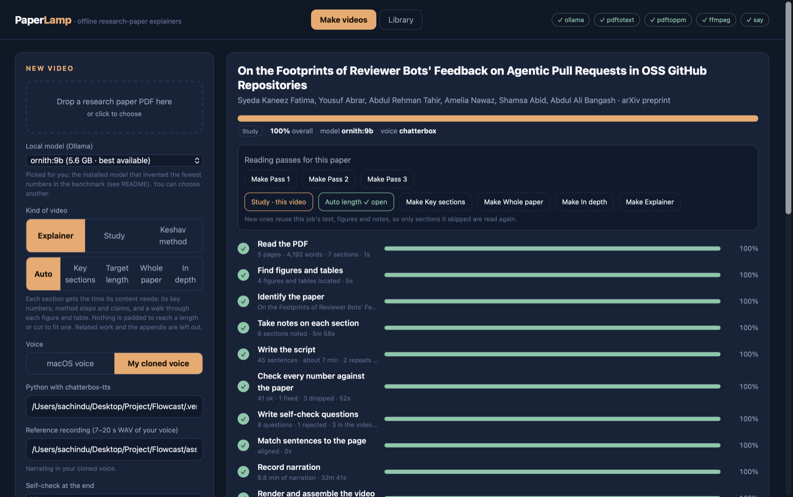
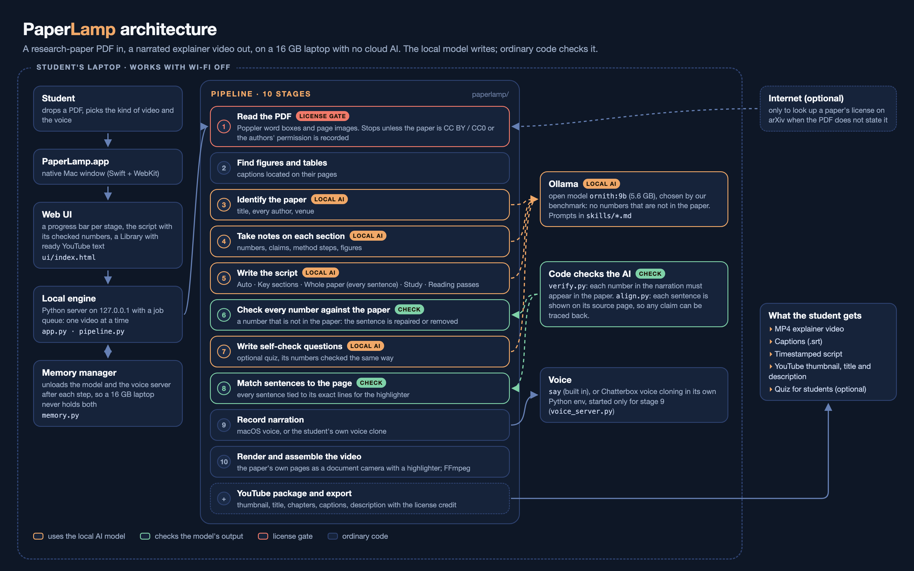

# PaperLamp

Turn a research paper PDF into a narrated, captioned explainer video, **entirely offline**.
A small local model (via [Ollama](https://ollama.com)) writes the script, every number is
checked against the paper, and a "document camera" moves across the real PDF pages while a
highlighter sweeps along the sentence being explained, like a lamp held over the page. No
external AI service is used at any point. The only network use is optional: looking up a
paper's license on arXiv when the PDF does not state it, and downloading arXiv papers for a
playlist.

_Formerly "paper2video". Renamed because two research projects already use that name
(Show Lab's Paper2Video / PaperTalker, and the code of Preacher)._



## At a glance

**Key features**

- Drop in a PDF, pick a kind of video and a voice, and get an MP4 with burned-in captions, an
  `.srt` file, a timestamped script, chapters and a ready YouTube thumbnail, title and description.
- The paper's own pages on screen as a document camera, with a highlighter on the exact sentence
  being explained and each figure framed while it is discussed.
- Every number in the narration is checked against the paper by code; a sentence with a number
  the paper does not contain is repaired or removed.
- Kinds of video for different reading goals: Auto, Key sections, Target length, Whole paper (every
  sentence), In depth (equations and terms), Study (built on learning research) and Keshav's three
  reading passes.
- A license gate: a video is made only when the paper's license allows adapted copies (CC BY
  family, CC0) or the authors' permission is recorded; the description carries the credit.
- Narration in the built-in macOS voice or in a clone of **your own** voice (Chatterbox), run locally.
- A Mac app with a progress bar per stage, a Library of finished videos, playlists, and a memory
  manager so the model and the voice clone never fill a 16 GB laptop together.

**Tech stack**

| Part | Technology |
|---|---|
| Desktop app | Swift (AppKit + WebKit) window around the local engine (`packaging/macos`) |
| User interface | one HTML + JavaScript page (`ui/index.html`) |
| Engine | Python 3 standard-library HTTP server and job queue (`app.py`), pipeline in `paperlamp/` |
| PDF reading | Poppler: `pdftotext -bbox-layout`, `pdftohtml`, `pdftoppm`, `pdfinfo` |
| Writing the script | Ollama running an open model locally: `ornith:9b` by default (chosen by `bench/`), `gemma4:E4B` to read equations off the page when there is no LaTeX source |
| Voice | macOS `say`, or Chatterbox (Resemble AI, open source) voice cloning in its own Python env on Apple's GPU |
| Frames, video and sound | Pillow and NumPy for frames; FFmpeg for H.264/AAC, loudness and captions |
| Optional network | arXiv API: license lookup, and metadata, PDF and LaTeX source for playlists |
| Tests | Python `unittest`, 134 tests (`tests/`) |

**Architecture**



**What works today**

Nothing in this repository is mocked: there is no sample data, fake screen or placeholder output.
Every video and number in the demo comes from a real run on a 16 GB MacBook.

| Status | What |
|---|---|
| Fully working, used on real papers | The 10-stage pipeline, the number check, the license gate, YouTube packaging, the Library, the Mac app and memory manager, macOS and cloned voices. Finished videos of these kinds: **Auto** (a 52-page paper gave a 13:49 video; a 5-page paper gave 5:50 in 16 minutes end to end), **Study** (9:22 in the cloned voice, with prequestions and recall questions), **Target length**, **Every section**, **Reading pass 1** (three papers) and **Reading pass 2** |
| Built and unit-tested, not yet run end to end | **Key sections**; **Whole paper** (its one long run stopped during narration when memory ran out, and can be resumed); **Reading pass 3**; **In depth**; playlists' **Make all** (a 10-paper playlist is imported, with one paper correctly blocked by its license, but its videos are not made yet) |
| Not built yet | Windows and Linux support, a signed and notarized installer, any web or cloud version |
| Known gap | The number check confirms a number appears in the paper, not that it belongs to the sentence on screen (a paper that reports 55.5% and 57.8% for the same thing passes either) |

## What it does

| Stage | What happens | Local tool |
|---|---|---|
| 1. Read the PDF | text, metadata, a line-level index of every page; sections from the PDF's outline, or from headings checked by font (small-caps headings are joined back, figure labels are ignored) | poppler (`pdftotext`, `pdftohtml`, `pdfinfo`) |
| 2. Find figures and tables | caption detection + region finding, used to frame and outline them | poppler + NumPy |
| 3. Identify the paper | title, authors, venue from the first page, then checked against page 1 (wrong titles and invented authors are replaced or dropped; arXiv preprints are labelled) | Ollama + Python |
| 4. Take notes | per-section facts: key numbers (copied verbatim), claims, method, limitations | Ollama |
| 5. Write the script | chapter by chapter from the notes: the paper (title, authors, venue — so the video opens on the title page), then intro, the paper's sections, limitations, takeaway. Each chapter is told which figures and tables it should walk through (with their captions) | Ollama |
| 6. Check every number | each number must occur in the paper; otherwise the model repairs the sentence or it is removed | Python |
| 7. Self-check questions (optional, off by default) | multiple-choice questions from the notes; every number in a question and its answer is checked and each question is re-asked to confirm its answer; they can end the video, and the set is saved as `quiz.md` | Ollama + Python |
| 8. Match sentences to the page | each sentence → page, lines to highlight, region to frame (figures/tables by label, else shared numbers and rare words) | Python |
| 9. Record narration | macOS system voice, or a clone of **your own** voice with Chatterbox | `say` / Chatterbox |
| 10. Render and assemble | document-camera video (pan/zoom; a highlighter that sweeps along the paper's own sentence, start to full stop, as it is spoken; figures kept bright with their caption highlighted), optional quiz cards, captions (ASS burned in + SRT), −14 LUFS audio, YouTube description with chapters | Pillow + ffmpeg |

### Kinds of video

**Study** videos are built on what learning research says works, to get the most out of a paper in
the least time (about 12 to 14 minutes for a 20-page paper):

| What the video does | Why |
|---|---|
| Opens with the big picture from the abstract | Read with a goal (Carey, Steiner & Petri, "Ten simple rules for reading a scientific paper", PLOS Comput Biol 2020) |
| Defines three key terms before the content | Mayer's pre-training principle |
| Short segments (under two minutes) on the method, results and discussion | Mayer's segmenting principle |
| Each segment opens with a question to keep in mind and ends with its answer | Prequestions improve learning from video (Carpenter & Toftness 2017; reviews by Pan & Carpenter 2023) |
| Says why each step or result matters | Self-explanation and elaborative interrogation (moderate utility in Dunlosky et al. 2013) |
| Explains every figure, reads the limitations critically | Carey et al., rules 4 and 6 |
| Leaves out related work and the appendix | Mayer's coherence principle |
| Ends with recall questions answered after a pause | Practice testing, high utility (Dunlosky et al. 2013) |
| Lists the questions in the description to answer a day later | Distributed practice, high utility (Dunlosky et al. 2013) |

Highlighting and rereading alone, the two most common study habits, rated low in Dunlosky et al.;
the highlighter here only shows where the narration is.

**Reading passes** follow S. Keshav's three-pass method ("How to Read a Paper", ACM SIGCOMM
Computer Communication Review, 2007), so a video does the reading the way an experienced reader
would:

| Pass | What the video covers | Typical length |
|---|---|---|
| **1. Is it relevant?** | title, authors and venue (preprints flagged); the abstract and introduction; how the paper is organised (each section heading highlighted); the conclusion; every figure and table read with its own caption; the references (the works it cites most, highlighted in the list); then what problem, what they did, what they found, and who should read further | 5 to 10 min |
| **2. The evidence** | the experimental setup first (data, baselines, metrics), then each result with what it compares, the limitations, and the references the evaluation leans on | 10 to 20 min |
| **3. The method in depth** | every method section step by step, the appendix, the assumptions the method rests on, and what you'd need to reproduce it | 20+ min |

```bash
python3 -m paperlamp.cli paper.pdf --pass 1 --voice chatterbox
```

Pass 1 reads figure captions as the authors wrote them rather than paraphrasing them: small local
models tend to mix up which result belongs to which figure.

Four other kinds of explainer:

- **Auto** (the app's default): every main section in order, each given as many sentences as its
  content needs: its key numbers, method steps and claims (counted once even when the notes repeat
  them), plus a walk through each figure and table. Nothing is padded to reach a length or trimmed
  to fit one; related work and the appendix are left out, and the limitations chapter is sized by how
  many the authors report. On two 20+ page papers this planned about 13 to 14 minutes, between the
  8-minute target and the whole-paper video; a short paper comes out shorter.
- **Key sections**: the methodology, results and discussion in detail, in the paper's order. Each
  section is its own chapter, labelled Method, Results or Discussion by its title (how a study is set
  up, such as its metrics or experimental setup, counts as method; an unnamed section is method before
  the first results section and results after it) and given what the whole-paper video would give it,
  and at least what its numbers, claims and figures need. The introduction, related work and
  background only feed a short opening; the appendix is left out. On the three papers tried this
  planned 14 to 20 minutes.
- **Target minutes** (default 8): sections share a sentence budget, and the finished script is
  trimmed to a hard word budget (about 130 words per minute of video), so the video lands near the
  target.
- **Whole paper**: every sentence of the paper, from the title to the last section, explained in
  plain words while the highlighter sits on that exact sentence (`paperlamp/reader.py`). The
  sentences come from poppler's layout in reading order, column by column, so the highlight never
  has to be guessed. Headings are read as they are, every author by name, and each figure and table
  caption is explained with the figure on screen. Running headers, page numbers, the arXiv stamp,
  the copyright box, the insides of figures and tables, display equations and the reference list
  are left out; the appendix only when asked (`--with-appendix`). The local model explains eight
  sentences at a time and must keep their numbers; an explanation that changes a number falls back
  to the paper's own sentence. Long: about 5 minutes of video per page. (The older whole-paper
  explainer, every section summarised in order, is still `--every-section`.)
- **In depth** (`--in-depth`, `paperlamp/deep.py`): the whole paper as a lecture, often hours long.
  Every sentence is explained at length (what it says, how it follows, why it matters), and each
  technical term is defined where the paper first uses it. Display equations are cut out of the page
  layout line by line (they often sit inside a paragraph, which Whole paper used to skip entirely),
  matched to the exact LaTeX in the paper's arXiv source (`paperlamp/texsrc.py`), then walked
  through: what the paper uses it for, the equation read aloud, each symbol with its meaning while
  that symbol is highlighted on the page, and the intuition. Without a LaTeX source a local vision
  model (gemma4:E4B) reads the equation off the page image. The video opens with what it covers,
  the key terms and the background the paper assumes; each main section opens with what it sets
  out to do and ends with a recap; every figure and table is walked through from the text inside
  it. `glossary.md` and `equations.md` are saved beside the video. Every model answer is cached in
  the job folder (`deep_cache.json`), so a stopped job resumes without asking again.

### Playlists

The Library has **Playlists**: paste arXiv links or IDs, one per line, and the app reads each
paper's title, every author, the date its first version appeared, the comment that often names
the venue, and its license from arXiv, then downloads the PDF and (for In depth) the LaTeX source.
A second link on a line is a PDF to use instead of arXiv's copy, for example a journal's
open-access version. Papers are listed as a timeline, oldest first by default (or newest first,
the order the videos were made, the order added). **Make all** makes a job per paper with the
playlist's kind of video (reusing an existing job's parsed text, figures and title when the paper
has one) and queues them in playlist order; one video is made at a time. A paper whose license
does not allow a video waits for a permission note. **Export folder** puts every finished video,
numbered in playlist order, with its thumbnail, captions, details and glossary, in one folder with
the playlist's own title and description for YouTube.

### Hours-long videos

- The narration track is written to disk as it is assembled (about 2 GB per 3 hours of WAV is never
  held in memory), and voice clips are hard-linked rather than copied.
- Rendered clips are kept with a key of what they show, so a render stopped by a quit resumes.
- Videos over 40 minutes, and every In depth video, drop the slow camera drift: a settled frame is
  drawn once and repeated, which renders faster and compresses to a fraction; they are encoded at
  CRF 23 and keep their narration as AAC (`narration.m4a`) instead of WAV.
- Chapter times switch to H:MM:SS past an hour, chapters shorter than YouTube's 10 seconds merge into
  the next, and a description over 5,000 characters keeps the main sections only.
- Voice and render stages stop with a clear message when the disk is too full for them.
- YouTube needs a verified channel for videos over 15 minutes, and allows up to 12 hours.

Every stage has its own progress bar in the web UI, writes its result into the job folder,
and can be resumed or re-run (for example after editing `script.json`).

### Papers whose license does not allow a video

Right after reading the PDF, a job checks the paper's license (in the PDF, or on its arXiv page) and
stops unless it lets anyone publish an adapted copy: CC BY, CC BY-SA, CC BY-NC (no monetisation),
CC BY-NC-SA or CC0. NoDerivatives licenses, arXiv's default license, no stated license, and an arXiv
page that could not be reached all stop the job before any model or voice work. If the authors or
the publisher give permission, say who and when on the job page (or `--permission "..."`); the job
then continues and the description notes the permission.

## Setup (macOS, Apple silicon tested)

```bash
brew install poppler ffmpeg
python3 -m pip install -r requirements.txt     # numpy, pillow
# Ollama app + one local model (the tool never downloads anything itself)
ollama list
```

Optional voice cloning (slow on a laptop, ~1 min per sentence): create a separate env with
`pip install chatterbox-tts "setuptools<81"`, record 7–20 s of your own voice as a WAV, and put
both paths in `config.json` (see `config.example.json`).

## Where finished videos go

Every video is always written to its job folder first. Set `export_dir` in `config.json` (or in the
app under *Save finished videos to*) to also collect every finished video in one browsable folder.
Each paper gets its own folder, numbered in the order you made the videos, so the folder list sorts
into that order:

```
Paper Videos/
  01 - SWE-Bench Can Language Models Resolve Real-World GitHub Issues (ICLR 2024)/
    video.mp4  captions.srt  captions.ass  description.txt  script.md  narration.wav
  02 - Attention Is All You Need (NeurIPS 2017)/
    ...
```

The job folder keeps its own copy, so exports can be deleted or redone at any time, and a job is
never renamed or moved out from under the app. Re-exporting a job overwrites only the files that
same job exported before and keeps its number, and a second video of the same paper gets a
subfolder rather than overwriting the first. A hidden `.paperlamp-exports.json` in the export
folder remembers which job owns which file and which number each paper has.

## Install the Mac app

```bash
packaging/build_app.sh            # builds PaperLamp.app and installs it in ~/Applications
```

PaperLamp.app opens in its own window and runs the engine in the background. Videos, settings and
the engine log live in `~/Library/Application Support/PaperLamp` (the menu's **Open Data Folder**).

Built for a 16 GB laptop:

- **One video at a time.** Others wait in line, so two jobs never hold the language model, the voice
  model and the renderer at once.
- **Each heavy step cleans up after itself.** The language model (about 6 to 7 GB) is unloaded as
  soon as the script is written; the voice-cloning server stops when the narration is recorded;
  render workers are sized to the free memory (one per 0.8 GB, up to four); the per-sentence clips are
  deleted once the final video exists.
- **Idle means empty.** When the queue is empty, and when you quit, every model is unloaded. The
  Memory panel shows free memory, what PaperLamp has loaded and the biggest memory users on the Mac,
  with a **Free Memory Now** button.
- Quitting while a video is being made asks first; the job resumes from where it stopped.

## Use

```bash
python3 app.py                     # web UI at http://127.0.0.1:8765
python3 -m paperlamp.cli paper.pdf --minutes 8 --voice say
python3 -m paperlamp.cli paper.pdf --auto-length --voice say
python3 -m paperlamp.cli paper.pdf --key-sections --voice chatterbox
python3 -m paperlamp.cli paper.pdf --whole-paper --voice chatterbox
python3 -m paperlamp.cli paper.pdf --in-depth --arxiv 2604.00594 --voice chatterbox
python3 -m paperlamp.cli paper.pdf --study --voice chatterbox
python3 -m paperlamp.cli --resume <job-id> --from verify     # re-run after editing script.json
```

Outputs land in `jobs/<id>/out/`: `video.mp4`, `captions.srt`, `description.txt`, `script.md`,
and `quiz.md` when the quiz is on (questions and answer key, e.g. for checking what students understood).

## Choosing the local model

Benchmarked on a 16 GB Apple M5 with the models already installed (no downloads): each model
extracted the facts of SWE-bench §2 as JSON. *Precision* = share of reported numbers that really
occur in the text; *recall* = share of 12 key numbers found (`bench/model_bench.py`).

| Model | Size | Precision | Recall | Time | Speed |
|---|---|---|---|---|---|
| **ornith:9b** (default) | 5.6 GB | **100%** | 92% | 79 s | 15 tok/s |
| bonsai-27b (1-bit) | 4.4 GB | 95% | 92% | 76 s | 14 tok/s |
| gemma4:E4B | 9.6 GB | 93% | 83% | 43 s | 23 tok/s |
| qwen3:14b | 9.3 GB | 95% | 67% | 128 s | 9 tok/s |

**ornith:9b is the smallest model that invented no numbers**, and it leaves room for the voice
model in 16 GB. bonsai-27b is the absolute smallest and also works; the number check catches its
occasional slip. Run the `choose-local-model` skill (or the benchmark) on a new machine.

The app selects the best installed model by this table (fewest invented numbers, then most key
numbers found; `BENCH_ORDER` in `paperlamp/llm.py`), and a job whose model has since been removed
falls back to it.

## Local model vs Claude

See [docs/COMPARISON.md](docs/COMPARISON.md): the same paper scripted by the local model and by
Claude, scored with metrics computed from the paper text (numbers verified, key-number coverage,
figure references, limitations, readability, repetition). Claude-written scripts for two papers are
in `examples/` and can be rendered by this tool (`--import`), so visuals and voice stay identical
and only the writing differs.

## How it compares with other paper-to-video systems

| | Input | What the viewer sees | Fact check | Runs on |
|---|---|---|---|---|
| **PaperLamp** | PDF | the paper's own pages, lines highlighted as they are explained | every number checked against the paper by code; title and authors checked against page 1 | a 16 GB laptop, offline |
| Paper2Video / PaperTalker ([Zhu et al. 2025](https://arxiv.org/abs/2510.05096), preprint) | LaTeX source, author photo and voice | new Beamer slides, a cursor, the author as a talking head | prompt instructions only | cloud LLM (GPT-4.1 recommended) and a 48 GB GPU |
| PresentAgent ([Shi et al. 2025](https://arxiv.org/abs/2507.04036)) | document | new slides with narration | none reported | cloud LLM |
| Preacher ([arXiv 2508.09632](https://arxiv.org/abs/2508.09632)) | paper | generated video segments (a "video abstract") | none reported | video generation models |
| NotebookLM Video Overviews ([Google, 2025](https://blog.google/innovation-and-ai/models-and-research/google-labs/notebooklm-video-overviews-studio-upgrades/)) | documents | narrated slides made from the sources | not published | Google cloud |

The difference is who it is for: PaperTalker presents a paper *as its author* (its scores reward
remembering the author's face). PaperLamp explains a paper to a reader who didn't write it, so it
shows the source instead of redrawing it, and it never animates anyone's face.

Ideas taken from that work, with thanks:
- the optional quiz follows Paper2Video's **PresentQuiz** metric (questions generated from the
  paper), turned into a self-check for people;
- the highlighter sweep is backed by their cursor ablation, where a visible cursor raised an AI
  viewer's localisation accuracy from 0.084 to 0.633 (measured with an AI viewer, not people);
- a hard word budget, like their 50-words-per-slide cap, keeps target-length videos on target.

## Claude Code skills

`.claude/skills/` contains skills for working on this repo with Claude Code:

- **paper-to-video**: run, resume and troubleshoot the pipeline
- **paper-script-review**: have Claude fact-check and improve a local-model script, then re-render
- **choose-local-model**: benchmark installed Ollama models and pick the default
- **compare-scripts**: compare two scripts for the same paper and write up the result

## Accuracy and responsible use

- **Numbers:** a number that doesn't appear in the paper never reaches the video (repaired or removed).
  Labels like "Figure 3" are ignored. Derived arithmetic in an imported script is reported, not removed.
- **Limitations** get their own chapter, built only from what the authors state.
- **Quiz questions** go through the same number check; malformed or unsupported questions are dropped,
  not repaired. Review `quiz.md` before using it for assessment.
- **The paper's pages are shown on screen, so the video is an adaptation of the paper.** The description
  is generated with the citation, the arXiv link, the license name and its URL, and a line saying the
  paper was changed and that the authors have not endorsed the video. It also says what the license
  actually permits:

  | License on the paper | The generated description says |
  |---|---|
  | CC BY 4.0 | publish and monetise, credit the paper, name the license, say you changed it |
  | CC BY-NC / CC BY-NC-SA 4.0 | publish only without monetisation; NC-SA also puts the same license on your video; ask the authors first |
  | CC BY-ND / CC BY-NC-ND 4.0 | these videos adapt the paper, so no derivatives: ask the authors for permission |
  | nothing found (arXiv's default, or publisher copyright) | no right to reuse is granted; ask the authors or the publisher before publishing |

  Detection is offline and reads only the paper's own text, so it misses a license held elsewhere
  (a journal's page, or a CC BY arXiv paper whose PDF says nothing). Correct `license` and `arxiv` by
  hand in `jobs/<id>/doc.json` and re-run the render stage. Fair use is arguable but decided case by
  case, and showing whole pages weighs against it; ask rather than rely on it. A takedown costs a
  channel strike, and three close the channel.
- **Voice cloning:** only clone a voice you have permission to use. Chatterbox output carries Resemble
  AI's inaudible watermark. YouTube's disclosure rules list cloning *your own* voice for voiceovers as
  not requiring disclosure; check the current rules for your case.
- Small local models still write flatter, less insightful scripts than a frontier model. Use the
  `paper-script-review` skill or edit `script.json` before publishing.

## Layout

```
app.py            web UI server (standard library only)      ui/index.html   the UI
paperlamp/pdf.py        text, sections, figure/table detection     paperlamp/llm.py      Ollama client
paperlamp/skills/*.md   prompt templates for each model task       paperlamp/analyze.py  per-section notes
paperlamp/script.py     chapter outline + narration                paperlamp/verify.py   number checking
paperlamp/align.py      sentence → page/lines/region               paperlamp/render.py   document camera
paperlamp/tts.py        say / Chatterbox backends                  paperlamp/voice_server.py  Chatterbox server
paperlamp/assemble.py   timeline, audio, captions, final mux       paperlamp/pipeline.py stages, state, resume
paperlamp/compare.py    script comparison metrics                  paperlamp/quiz.py     self-check questions
paperlamp/passes.py     reading-pass videos (Keshav)               paperlamp/memory.py   memory status and cleanup
paperlamp/reader.py     whole paper, sentence by sentence          paperlamp/deep.py     in-depth videos
paperlamp/texsrc.py     equations from the LaTeX source            paperlamp/arxiv.py    arXiv details, PDF, source
paperlamp/playlist.py   playlists in the Library
packaging/              the Mac app (Swift window, icon, build)
bench/                  model benchmark, exports                   tests/                unit tests
```

## License

MIT, see [LICENSE](LICENSE).
